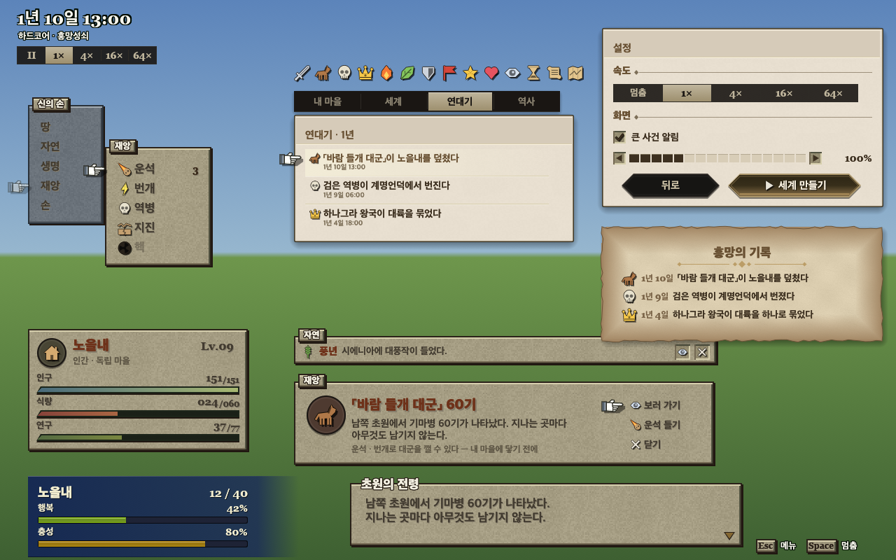

# game-ui

An egui game UI kit that uses the screen language of *Final Fantasy Tactics*: PS1 (1997) and *The Ivalice Chronicles* (2025). The colours and sizes are measured from the originals (`docs/research/fft-ui-research.md` in deskarium).



## What is in it

- **Units.** `u` is one original pixel, 2 points rounded to whole physical pixels (`skin::unit`). Every line is a filled rect 1u thick, snapped to the pixel grid.
- **Windows (`frame`).**
  - Classic plate: khaki texture #a59d83, 1u ink outline, top-only highlight, right and bottom shade, hard 1u shadow.
  - Slate: an inactive parent window.
  - Page: TIC cream, for reading screens.
  - HUD: TIC navy that fades out to the right.
  - Parchment: burnt edges.
  - Extras: tab labels, header bands and gold rules.
- **Selection is pointed at, never tinted.**
  - `menu::Menu` draws the gauntlet hand. It snaps between rows and bobs in 2 steps.
  - A ghost hand stays on the parent window.
  - Keyboard ↑ ↓ Enter works.
- **Controls (`controls`).**
  - Lozenge buttons and Classic tab strips: the selected cell is inverted.
  - TIC tab bar, engraved icon cells and a ‹ value › stepper.
  - Stat rows with dot leaders, and key-hint plates.
- **Gauges (`gauge`).** The Classic slanted bar with a horizontal gradient on plates. The TIC 3-stop tube on the HUD.
- **Messages (`message`).**
  - Large notices: tab label, icon disc, 「name」 title and a short command list.
  - Small notices: a single-line plate.
  - Dialogue with the speaker name on the top border, plus a continue marker.
- **Text (`text`, `fonts`).**
  - OS Korean font plus Georgia old-style numerals (`fonts::num`).
  - Ink shadow on plates, outlined cream text on the 3D scene.
- **Icons (`icons`).** 60 vector icons with an outline pass. The hand cursor is in `cursor`.

There are no rounded cards, glows, accent colours or emoji.

## Use

```rust
game_ui::fonts::install(&ctx);
game_ui::theme::apply(&ctx, 1.0);
egui::Area::new("cmd".into()).show(&ctx, |ui| {
    game_ui::frame::show_titled(ui, game_ui::frame::Kind::Menu, "명령", |ui| {
        let items = [game_ui::menu::Item::new("이동"), game_ui::menu::Item::new("행동")];
        if let Some(k) = game_ui::menu::Menu::new("cmd", &items).show(ui) { /* k picked */ }
    });
});
```

## Gallery and tests

```sh
cargo run -p game-ui --example gallery --features snapshot -- out.png "" 2.0   # offscreen render to PNG
cargo test -p game-ui                                                          # measured tokens, u snapping, plate texture noise
```
